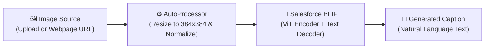

# 🖼️ AI Image Captioner — Web Scraping & Vision AI

An AI-powered image captioning application powered by **Salesforce BLIP** (~0.25B parameters). Upload a photo or paste any webpage URL — the application automatically scrapes, filters, downloads, and describes every image found.

[](https://colab.research.google.com/github/mitadrudeb/ai-image-captioner/blob/main/AI_Image_Captioner.ipynb)


---

## ✨ Features

| Feature | Description |
|---------|-------------|
| **📤 Single Image Upload** | Drag & drop any photo from your device to generate an instant natural language caption |
| **🌐 Webpage URL Scraping** | Input any webpage URL (e.g., Wikipedia) → auto-extract, filter, and caption all images |
| **🛡️ Defensive Scraping** | Automatically ignores SVGs, base64 data URIs, and tiny icons/tracking pixels (< 400px) |
| **⚡ Lightweight & Fast** | Uses **Salesforce BLIP (~247M params)**; runs in seconds on consumer CPUs & accelerates on CUDA GPUs |
| **💻 Cross-Platform** | Zero external compilers; runs out-of-the-box on **Google Colab, Windows, Linux, and macOS** |
| **🆓 Zero Cost** | 100% open-source with no paid API keys required |

---

## 🤖 Model Details

| Model | Parameters | Architecture | Hub Link |
|-------|------------|--------------|----------|
| **Salesforce/blip-image-captioning-base** | ~247M (~0.25B) | ViT-B/16 Vision Encoder + BERT Text Decoder | [Hugging Face Model Card](https://huggingface.co/Salesforce/blip-image-captioning-base) |

---

## 🚀 Quick Start

### Option 1: Google Colab (Recommended — 1-Click Run)

Click the badge below to run the project directly in Google Colab with free GPU acceleration:

[](https://colab.research.google.com/github/mitadrudeb/ai-image-captioner/blob/main/AI_Image_Captioner.ipynb)

### Option 2: Run Locally

```bash
# 1. Clone the repository
git clone https://github.com/mitadrudeb/ai-image-captioner.git
cd ai-image-captioner

# 2. Create and activate a virtual environment
python -m venv venv
source venv/bin/activate        # Linux / macOS
# venv\Scripts\activate          # Windows

# 3. Install dependencies
pip install -r requirements.txt

# 4. Launch the Jupyter Notebook
jupyter notebook AI_Image_Captioner.ipynb
```

The Gradio web application will open locally at `http://127.0.0.1:7860`.

---

## 📸 How It Works



### 1. Upload Mode
1. User uploads an image through the Gradio interface.
2. The image is converted into an RGB array and passed to the BLIP processor.
3. The model autoregressively generates descriptive text tokens and decodes them.

### 2. URL Scraping Mode
1. User provides a webpage URL (e.g. Wikipedia).
2. `BeautifulSoup` parses the HTML and extracts all `` tags (`src`, `data-src`, `srcset`).
3. Relative paths are converted to absolute URLs using `urllib.parse.urljoin`.
4. Invalid formats (SVGs, data URIs, icons `< 400px`) are filtered out.
5. Up to `max_images` are downloaded in-memory and captioned sequentially.

---

## 🛠️ Tech Stack

- **[Hugging Face Transformers](https://huggingface.co/docs/transformers)** — Model weights, tokenizer, and image processor
- **[PyTorch](https://pytorch.org/)** — Deep learning framework and tensor operations
- **[Gradio](https://gradio.app/)** — Interactive web UI with public sharing tunnels
- **[BeautifulSoup4](https://www.crummy.com/software/BeautifulSoup/)** — HTML parsing and web scraping
- **[Pillow](https://pillow.readthedocs.io/)** — Image manipulation and validation
- **[Requests](https://requests.readthedocs.io/)** — HTTP client for web ingestion

---

## 📂 Project Structure

```
ai-image-captioner/
├── AI_Image_Captioner.ipynb   # Main Jupyter notebook (ready to run)
├── requirements.txt           # Minimal, clean dependencies
├── README.md                  # Project overview and documentation
├── LICENSE                    # MIT License
└── .gitignore                 # Git ignore rules (caches, models, checkpoints)
```

---

## 💡 What I Learned

This project was built to understand fundamental concepts in multimodal AI engineering:

- **Vision-Language Alignment:** How Vision Transformers (ViT) patchify images into visual tokens that cross-attend with text token embeddings.
- **Edge-Ready Efficiency:** Using compact ~250M parameter models that execute in seconds on standard CPU hardware without multi-GPU overhead.
- **Defensive Ingestion:** Handling real-world web data quirks (relative URLs, vector graphics, tracking pixels, rate limits).
- **Interactive Prototyping:** Structuring modular Gradio blocks with tabbed workflows and public tunneling.

---

## 📄 License

This project is licensed under the MIT License — see the [LICENSE](LICENSE) file for details.
